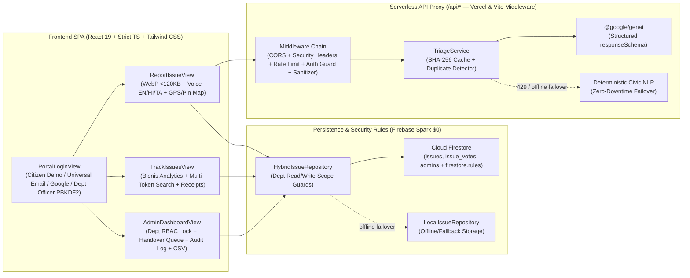

# CivicResolve — Codebase Architecture & AI Evaluator Map

This document maps every module, data flow, security boundary, and test suite in **CivicResolve** so automated reviewers and engineers can navigate the entire system quickly.

---

## 1. High-Level System Architecture

---

## 2. Directory & Responsibility Map

### `shared/` — Single Source of Truth Contracts & Zod Schemas
- `shared/index.ts` — Barrel entry exporting all shared types and schemas.
- `shared/types/civic.ts` — Locked domain unions (`ISSUE_CATEGORIES`, `DEPARTMENTS`, `PRIORITY_LEVELS`, `ISSUE_STATUSES`), `CivicIssue`, `CivicSession` (with `assignedDepartment`), `TriageRequest`, `TriageResponse`, `MAX_ISSUES_LIMIT = 50`.
- `shared/schemas/triage.ts` — Zod validation schemas for triage requests, structured AI responses, and `safeCivicText` XSS sanitizer.
- `shared/schemas/issue.ts` — Exact 22-field `CivicIssueSchema` aligned 1:1 with `firestore.rules`, plus `IssueCreateSchema`, `IssueUpdateSchema`, and `IssueFilterSchema`.

### `api/` & `server/` — Hardened Serverless AI Proxy
- `api/health.ts` — `GET /api/health` runtime readiness check (never leaks secret values).
- `api/triage.ts` — `POST /api/triage` multimodal issue classification endpoint.
- `api/_lib/env.ts` — Strict Zod server environment parser (`GEMINI_API_KEY` server-only).
- `api/_lib/http.ts` — Framework-agnostic HTTP adapters, request ID correlation, and error secret redaction.
- `api/_lib/middleware/` — Isolated security middleware:
  - `securityHeaders.ts` (CSP, HSTS, `X-Frame-Options: DENY`, `X-Content-Type-Options: nosniff`, `Permissions-Policy`, `Cache-Control: no-store`)
  - `cors.ts` (explicit allowlist + `OPTIONS` preflight)
  - `rateLimit.ts` (sliding-window IP limiter with `429` + `Retry-After`)
  - `authGuard.ts` (optional `STRICT_AUTH_LOCKDOWN` constant-time Bearer guard)
  - `sanitize.ts` (control-char/HTML sanitization + upload MIME/size enforcement)
- `api/_lib/triage/` — AI classification pipeline:
  - `geminiTriage.ts` (`@google/genai` with `TRIAGE_RESPONSE_SCHEMA` + live Flash model cascade)
  - `heuristicTriage.ts` (deterministic zero-downtime civic NLP failover)
  - `triageCache.ts` (canonical order-independent SHA-256 LRU cache)
  - `duplicateDetector.ts` (Haversine `<= 500m` geospatial + Jaccard similarity matcher)
  - `triageService.ts` (cache → Gemini → heuristic orchestrator)
- `server/devServer.ts` — Express 5 runtime mounted both standalone and inside `vite.config.ts` dev/preview middleware.

### `src/lib/` — Client Domain Services & Repositories
- `src/lib/index.ts` — Barrel facade of client library modules.
- `src/lib/firebase/config.ts` — Spark-only modular Firebase initialization (`firebase/app`, `firebase/auth`, `firebase/firestore`, zero Blaze SDKs).
- `src/lib/auth/`:
  - `authService.ts` — Core session orchestrator (Citizen Google/Email/Demo Guest + Municipal Admin Demo & Verified Department Officer login).
  - `authTypes.ts`, `authErrorMapper.ts`, `localAuthStore.ts` — Strict auth contracts, Firebase error mapper, and Zod-validated session/account storage.
  - `emailAuthHandler.ts` — Hardened email sign-in/sign-up with strict password verification (zero password-bypass fallback on existing Firebase or offline PBKDF2 accounts).
  - `officerAuthHandler.ts` — Department clearance scope verifier (`assertDepartmentClearance`) for PBKDF2 roster and Firebase `admins/{uid}` officers.
  - `passwordHasher.ts` — Web Crypto `PBKDF2-HMAC-SHA256` (`100,000` iterations, 16-byte random salt, constant-time comparison).
  - `departmentRoster.ts` — Salted PBKDF2-SHA256 department officer directory (zero plaintext passkeys).
- `src/lib/repositories/`:
  - `issueRepository.ts` — `IssueRepository` interface, Zod input checks, state-transition machine, and department RBAC guards (`applyDepartmentReadScope`, `assertDepartmentReadAccess`, `assertDepartmentWriteScope`).
  - `firestoreIssueRepository.ts` — Atomic `runTransaction` upvoting, bounded `limit(50)` queries, and `getVerifiedAdminProfile`.
  - `localIssueRepository.ts` — Browser `localStorage` fallback seeded with 6 realistic municipal issues (`seedIssues.ts`) using Web Crypto `generateSecureId`.
  - `hybridIssueRepository.ts` — Automatic zero-downtime failover between Firestore and Local + sandbox overlay for unverified Demo Admin mutations.
- `src/lib/admin/adminWorkflowStore.ts` — Zod-validated Cross-Department Handover Request queue and Immutable Municipal Audit Log (Web Crypto IDs).
- `src/lib/media/` — Client-side Canvas WebP compressor (`< 120 KB`) and RIFF/WEBP magic-byte validator.
- `src/lib/i18n/` — Modular tri-lingual dictionary (`types.ts`, `locales/en.ts`, `locales/hi.ts`, `locales/ta.ts`, `translations.ts`) + voice recognition locales (`en-IN`, `hi-IN`, `ta-IN`).
- `src/lib/export/civicExport.ts` — OWASP formula-injection-safe CSV exporter and printable official citizen receipt generator.
- `src/lib/utils/` — Shared pure helpers: `secureId.ts` (Web Crypto CSPRNG IDs, zero `Math.random()`), `issueDisplay.ts` (shared priority dots, step indices, multi-token search matcher), `analyticsMetrics.ts` (SLA health score & 6-day trend math), and `slaUtils.ts`.

### `src/hooks/` & `src/components/` — Role-Isolated, Code-Split UI Views
- `src/hooks/useScrollAtmosphere.ts` — Passive rAF scroll-driven CSS variable driver.
- `src/components/layout/` — `ErrorBoundary.tsx`, `TopNav.tsx`, `BionisSidebar.tsx` (sticky desktop rail + Escape-dismissible mobile drawer).
- `src/components/auth/` — `PortalLoginView.tsx`, `CitizenPortalCard.tsx`, and `AdminPortalCard.tsx` (Dual-Portal Sign-In Gate with 1-Click Demo Mode for both Citizens & Admins).
- `src/components/report/` — Lazy-loaded `ReportIssueView.tsx`, `samplePresets.ts`, and `TriagePreviewPanel.tsx`.
- `src/components/map/` — `CivicMap.tsx`, `mapGeocoding.ts`, and `LeafletFallbackMap.tsx` (`@vis.gl/react-google-maps` `AdvancedMarker`, `mapId="DEMO_MAP_ID"`, `internalUsageAttributionIds={['gmp_git_agentskills_v1']}` + Leaflet/OSM failover).
- `src/components/dashboard/` — `BionisAnalyticsRow.tsx` (accessible `role="img"` SVG charts), lazy-loaded `TrackIssuesView.tsx`, and semantic `TrackIssueCard.tsx` (`role="progressbar"`, keyboard-native buttons).
- `src/components/admin/` — Lazy-loaded `AdminDashboardView.tsx`, `AdminQueueFilters.tsx`, `AdminHandoverQueue.tsx`, `AdminAuditLogPanel.tsx`, and `AdminIssueCard.tsx`.
- `src/components/spec/DimensionalSpecModal.tsx` — Lazy-loaded Escape-dismissible monochrome CAD geometry spec sheet dialog.

---

## 3. Security & RBAC Control Matrix
| Security Control | Primary Implementation | Automated Test Proof |
| :--- | :--- | :--- |
| Server-Only `GEMINI_API_KEY` | `api/_lib/env.ts`, `.gitignore` | `tests/api/full17PointSecurityAudit.test.ts`, `tests/e2e/f1-f2-contracts.e2e.test.ts` |
| Department-Scoped Admin RBAC | `src/lib/repositories/issueRepository.ts`, `src/lib/auth/authService.ts`, `firestore.rules` | `tests/lib/issueRepository.test.ts`, `tests/lib/authService.test.ts`, `tests/lib/firestoreRules.test.ts`, `tests/ui/app.ui.test.tsx` |
| PBKDF2-SHA256 Passkey Verification | `src/lib/auth/passwordHasher.ts`, `src/lib/auth/departmentRoster.ts` | `tests/api/full17PointSecurityAudit.test.ts`, `tests/lib/authService.test.ts` |
| 11 HTTP Security Headers & CORS | `api/_lib/middleware/securityHeaders.ts`, `cors.ts`, `vercel.json` | `tests/api/middleware.test.ts`, `tests/api/securityPosture.test.ts`, `tests/e2e/f7-security-posture.e2e.test.ts` |
| Sliding-Window Rate Limiting | `api/_lib/middleware/rateLimit.ts` | `tests/api/full17PointSecurityAudit.test.ts` |
| Atomic Replay-Safe Upvoting | `firestore.rules` (`getAfter()`), `firestoreIssueRepository.ts` | `tests/lib/firestoreRules.test.ts`, `tests/lib/issueRepository.test.ts` |
| OWASP CSV Formula Sanitization | `src/lib/export/civicExport.ts` | `tests/ui/app.ui.test.tsx` |
